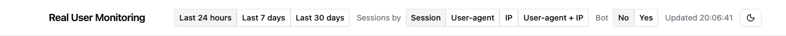
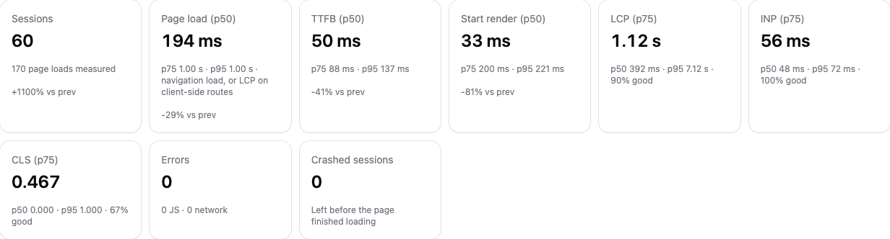
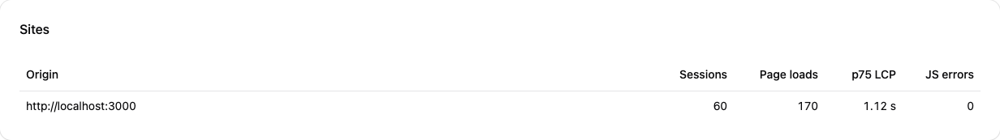
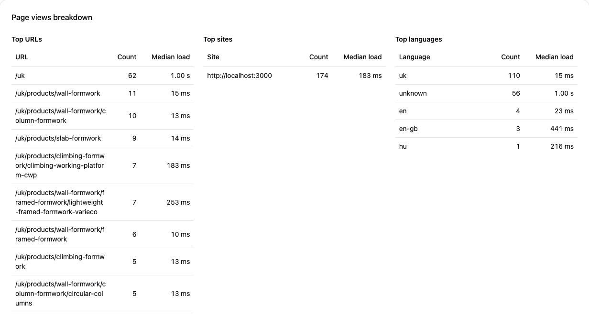
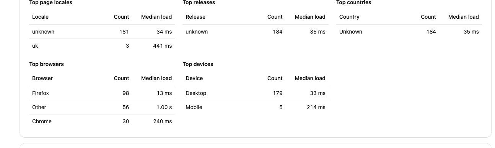
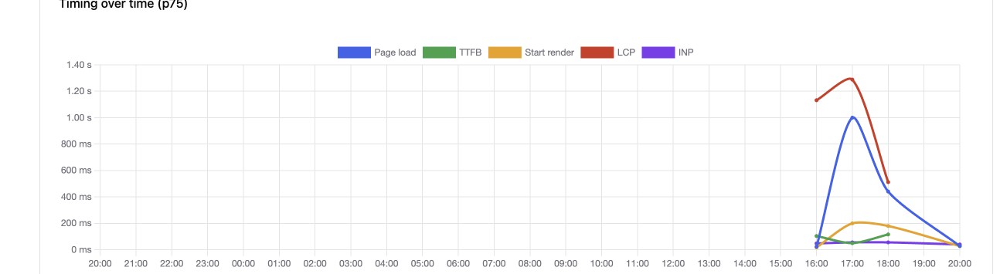
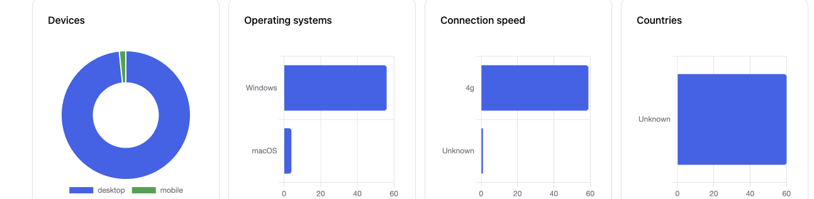
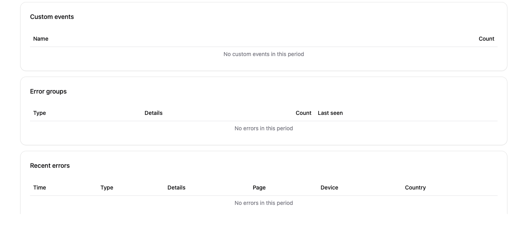

# Monitor

A small Real User Monitoring app. A monitored site loads `rum.js`, which reports page timing, errors, and visitor context. One Node process stores those events in SQLite and serves a dashboard of charts and breakdowns.

## What it collects

The snippet at `/rum.js` batches events to `POST /collect` on the host that served it.

| Event | What it records |
| --- | --- |
| Timing | Page load, TTFB, start render, LCP, INP, and CLS. Client-side route changes send a timing event too. |
| JavaScript errors | Exceptions and unhandled promise rejections |
| Network errors | Failed `fetch` and `XMLHttpRequest` calls |
| Crashes | The page was hidden before it finished loading |
| Custom events | Names sent with `rum.track("pdf-open")` |

Each event also includes a session id, path, **browser language** (`navigator.language`), **page locale** (`<html lang>` — never inferred from the URL), device type, operating system, connection speed, and optional **release**. The server adds the request origin, country, and browser family. Raw IP addresses and User-Agent strings are not stored; grouping uses salted hashes. Events older than 30 days are deleted.

## Features

The dashboard covers the last 24 hours, 7 days, or 30 days. Sessions can be grouped by session id, user-agent, IP, or both. Bot traffic can be included or excluded. Click a URL, site, language, locale, or release in the tables to scope every chart and total. Summary cards compare the current window to the previous one of the same length, and Core Web Vitals show the share of loads that were “good”. Collect health appears when beacons go stale or `/collect` rejects traffic. An optional webhook can POST when p75 LCP or the JS error rate is high.

**Range, grouping, and bots**



**Summary**

Sessions, page load / TTFB / start render (p50 with p75 and p95), LCP / INP / CLS (p75 with p50, p95, and % good), JS/network errors, and crashed sessions. Timing cards include change vs the previous window.



**Sites**

Origins that posted events, with sessions, page loads, p75 LCP, and JS errors.



**Page views**

Breakdowns by URL, site, and language, with counts and median load time. Click a row to filter.



Locale (`<html lang>`), release, country, browser, and device sit in the same card.



**Timing over time**

p75 page load, TTFB, start render, LCP, and INP across the selected range.



**User context**

Device type, operating system, connection speed, and country.



**Custom events and errors**

`rum.track` counts, errors grouped by type and message, and a recent-error log with page, device, and country.



## Run

Requires Node.js 20.12+ and pnpm.

```sh
pnpm install
pnpm dev
```

`pnpm dev` listens on port 4000 and rebuilds the dashboard as you edit it. `pnpm start` builds the dashboard, then serves it.

On a monitored site, add:

```html
<script src="http://localhost:4000/rum.js"></script>
```

Optional attributes (or `?v=` / `?sample=` on the script URL):

```html
<script
  src="http://localhost:4000/rum.js"
  data-release="2026-10-13"
  data-sample="1"
></script>
<script>
  rum.track("pdf-open");
</script>
```

`data-release` is a deploy id (`[A-Za-z0-9._-]`, up to 64 characters). `data-sample` is a fraction from 0 to 1 (default 1). Custom event names are lowercase (`[a-z0-9][a-z0-9._-]{0,63}`).

In development, beacons are accepted from `http://localhost:3000`. The dashboard has no login until credentials are set.

## Production

Set these in `.env`:

| Variable | Purpose |
| --- | --- |
| `NODE_ENV` | `production` |
| `MONITOR_PORT` | Listen port (default `4000`) |
| `MONITOR_SITE_ORIGINS` | Comma-separated origins allowed to post events |
| `MONITOR_DASHBOARD_USER` | Dashboard basic-auth user |
| `MONITOR_DASHBOARD_PASSWORD` | Dashboard basic-auth password |
| `MONITOR_HASH_SALT` | Salt for IP and User-Agent hashes (at least 16 characters) |
| `MONITOR_DB_PATH` | SQLite file (default `data/rum.sqlite`) |
| `MONITOR_TRUST_PROXY` | Set when a reverse proxy terminates TLS, so visitor IPs stay correct |
| `MONITOR_ALERT_WEBHOOK` | Optional. POST JSON here when p75 LCP or JS error rate is high (humans, last 24h) |

Then `pnpm start`, and point the site's script tag at this server's `/rum.js`.

## Docker

One container serves the dashboard, `/api`, `/collect`, and `/rum.js`. SQLite lives on a volume, not in the image.

**Development** (Vite HMR, source bind-mounted, no `.env` required):

```sh
docker compose -f docker-compose.dev.yml up --build
```

Dashboard: `http://localhost:4000`. Beacons are accepted from `http://localhost:3000`.

**Production:**

```sh
cp .env.example .env
# set MONITOR_SITE_ORIGINS, MONITOR_DASHBOARD_USER,
# MONITOR_DASHBOARD_PASSWORD, and MONITOR_HASH_SALT (at least 16 characters)

docker compose up --build
```

Compose refuses to start until those four variables are set. Events persist in the `monitor-data` volume.

The container listens on port 4000 internally. DNS and a reverse proxy (nginx, Caddy, Traefik) own the public hostname on 443; set `MONITOR_TRUST_PROXY=true` when TLS terminates in front of the container. `MONITOR_SITE_ORIGINS` is the site that embeds the snippet, not the monitor's own URL.

On the monitored site:

```html
<script src="https://monitor.example.com/rum.js" data-release="2026-10-13"></script>
```
